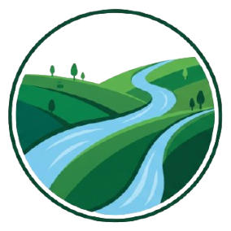
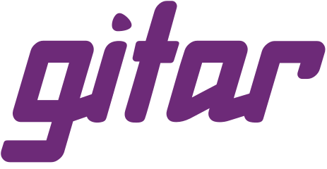

<p align="center"></p>
<h1 align="center">Tengoku (天国)</h1>
<p align="center"><em>An AI-first formal mathematics library for Lean 4 agentic theorem provers.</em></p>
<p align="center">
<a href="lean-toolchain"></a>
<a href="https://competemath.com/tengoku"></a>
</p>

## About
Formal mathematics is mathematics that a computer can check, step by step. It is scattered across hundreds of separate
projects, written for different versions of the language, Lean 4. Tengoku brings them together in one verified library
on one version, so that agentic theorem provers can use all of it at once. A theorem in Tengoku is declared trusted (or Leak-trusted) 
if it compiles from scratch in the self-contained Tengoku tree, on one of the pinned Lean toolchains listed in the badges 
above, with no sorry, only the standard 3 axioms, and passing checks intended to catch contradictory assumptions.

One of the things we would like to see is that Tengoku significantly improves the proving capacity of an [ATP](https://en.wikipedia.org/wiki/Automated_theorem_proving), compared
to when it uses Mathlib. We also hope that the unification of many disparate libraries makes it easier for ATPs to bridge
seemingly unrelated mathematics, and the discovery of new mathematics. Finally, we hope Tengoku acts as a continuously improving, 
reliable context for automated theorem provers. By reliable, we mean a system designed to be exceptionally cynical of all dependencies, even the Lean 4 kernel and elaboration ecosystem - [why](docs/why-cynical.md) and [how](docs/reliability.md) we do that.

(Tengoku can be interpreted to mean sky kingdom, or heavenly abode. This represents our ambition for the useful knowledge in this repository to reach the skies.)

## Try it
[Leak](https://competemath.com/about/leak) is the intended interface to Tengoku.

- **Add the MCP tools to your agent** (free, no sign-up): [Leak I](https://github.com/mikael-bashir/leak-i) searches
  (Loogle + Moogle + ChromaDB), [Leak II](https://github.com/mikael-bashir/leak-ii) steps through proofs (Pantograph service with efficient proof state switching),
  [Leak IV](https://github.com/mikael-bashir/leak-iv) verifies a script (Lean kernel daemon). All of these services use the Tengoku
  environment, and are provided like this to make it easy for the community to experiment - no SLA or uptime guarantee is provided.
  <details><summary>Connection URLs</summary>

  ```
  claude mcp add --transport sse tengoku-search https://barkingtree-leak-i.hf.space/sse
  claude mcp add --transport sse tengoku-proof  https://barkingtree-leak-ii.hf.space/sse
  claude mcp add --transport sse tengoku-verify https://barkingtree-leak-iv.hf.space/sse
  ```

  </details>
- **Search it on the web:** [competemath.com/tengoku](https://competemath.com/tengoku), in plain English or by name.
- **Run your own:** the [service code](https://github.com/mikael-bashir/leak-services).
- **HTTP API:** [docs/api.md](docs/api.md).
- **Download it:** clone this repository and run `scripts/cache.sh get` to download the compiled library.

## Contributors
Anyone can contribute, by hand or with AI. Because of the nature of this project, there are many indirect ways 
to contribute and support. Interacting with and providing feedback for the main [site](https://competemath.com), as
well as using and improving the [Leak](https://github.com/mikael-bashir/leak-services) services, all support Tengoku indirectly. 

We expect that realistic contributions directly to the project via pull requests will require AI assistance. This is because 
parts of the repository change before a human can fully understand it. We understand that this creates a barrier to entry for 
contributors due to factors beyond their control. We are not really in a position to solve this issue; if you
want to contribute directly, or want to learn about something that interests you, but can't because you don't 
have access to AI tools, get in [touch](mailto:bashir.mikael@outlook.com?subject=Tengoku) - we will try to help if we have the availability. 

For every other prospective contributor, you may work on whatever you wish, even if it initially doesn't
seem like it is related to Tengoku (if you have an odd idea or need particular permissions, get in touch with the link above).
However you contribute, it would be useful to make mention of what you are working on, or would like work to be directed 
at, in the [goals](GOALS.md) file.

[How credit works](docs/credit.md) · [Contributing](CONTRIBUTING.md) · [How a theorem gets in](docs/how-a-pr-flows.md) · [Code of Conduct](https://github.com/competemath/.github/blob/main/CODE_OF_CONDUCT.md) · [Posting guidelines](https://github.com/competemath/.github/blob/main/POSTING.md) · [Found an issue, or have an idea?](https://github.com/competemath/tengoku/issues/new) · [Found a security problem?](SECURITY.md). 

If you are unsure if an issue is a security problem, assume it is.

## Learn more
- [Why Tengoku does not trust the toolchain](docs/why-cynical.md): case studies of Lean 4 failures
- [How Tengoku stays reliable](docs/reliability.md)
- [Training on Tengoku](docs/for-labs.md): what labs must do, and what we ask
- [What Tengoku guarantees](docs/why-tengoku.md)
- [The full manual](https://competemath.com/about/tengoku)
- [Security and licence compliance](docs/openchain/README.md) (OpenChain ISO/IEC 18974 and 5230)
- [Acknowledgements](docs/acknowledgements.md): the projects and people Tengoku stands on
- Cite it: [10.5281/zenodo.23050400](https://doi.org/10.5281/zenodo.23050400), or the *Cite this repository* button

## Thanks
Tengoku makes extensive use of the Lean and Mathlib ecosystem - to the authors who make Tengoku possible, thank you.

<a href="https://snyk.io"></a>&nbsp;**Security, with [Snyk](https://snyk.io).** Tengoku is proud to be a member of Snyk's [Secure Developer Program](https://snyk.io/open-source/), which arms open-source maintainers with its advanced developer-security platform.

<a href="https://gitar.ai"></a>&nbsp;**Code review and CI repair, with [Gitar](https://gitar.ai).** Tengoku is proud to have been admitted to Gitar's open-source program, which gives open-source maintainers its AI code-review and CI-fixing agent.

## Funding and affiliation

Tengoku is one of the services of [CompeteMath](https://competemath.com/about). CompeteMath has no intention of generating income with any of its projects. CompeteMath is not affiliated with, nor does it support, any particular organization, corporate entity, or political group. Anyone considering donating or partnering with us should know that Tengoku will not allow any influence over the governance of this repository, nor its accessibility, the integrity of its contents, or [Tengoku's goals](GOALS.md).

## Badges

<p align="center">
<a href="https://doi.org/10.5281/zenodo.23050400"></a>
<a href="https://scorecard.dev/viewer/?uri=github.com/competemath/tengoku"></a>
<a href="https://www.bestpractices.dev/projects/15102"></a>
<a href="LICENSE"></a>
<a href="https://app.fossa.com/projects/git%2Bgithub.com%2Fcompetemath%2Ftengoku?ref=badge_small"></a>
<a href="https://sonarcloud.io/summary/new_code?id=competemath_tengoku"></a>
<a href="https://codecov.io/gh/competemath/tengoku"></a>
</p>
